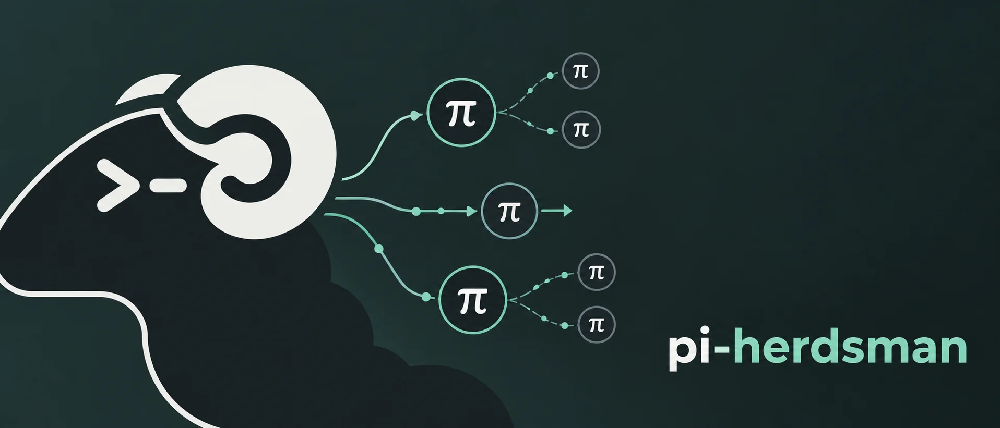

# Pi Herdsman 🐏



[](https://www.npmjs.com/package/pi-herdsman)
[](https://github.com/boadij/pi-herdsman/actions/workflows/validate.yml)
[](https://github.com/boadij/pi-herdsman/actions/workflows/validate.yml)
[](LICENSE)

**The orchestration layer between [Pi](https://github.com/earendil-works/pi) and [herdr](https://github.com/herdrdev/herdr).**

Pi Herdsman lets your AI coding assistant delegate work to background Agents
while your conversation stays interactive, or coordinate larger projects across
independent, branch-based Leads. Pi handles model conversations, herdr manages
terminal sessions and workspaces, and Herdsman coordinates delegation,
ownership, and supervision.

## Emergent agentic workflows

**Define the boundaries, not the workflow.**

Fixed agent pipelines prescribe the next handoff. Pi Herdsman instead lets models
decide how to split work, delegate to permitted Agents or Leads, and sequence or
parallelize tasks as results arrive. The execution path emerges at runtime,
while Herdsman enforces delegation permissions, ownership, project assignments,
and supervision.

You can still bring your own workflow and Agent definitions. See
[Coordination](docs/concepts/coordination.md#emergent-workflows-explicit-boundaries)
for the underlying model.

## Demo

_Advanced orchestration: a live Manager → Lead → Agent workflow._

[](https://github.com/user-attachments/assets/d6ee6687-a96d-493e-ae75-429f586be393)

## Quick start

**Linux/macOS:**

```sh
curl -fsSL https://raw.githubusercontent.com/boadij/pi-herdsman/main/install.sh | sh
```

**Windows (PowerShell):**

```powershell
irm https://raw.githubusercontent.com/boadij/pi-herdsman/main/install.ps1 | iex
```

**Already using Pi and herdr?**

```sh
pi install npm:pi-herdsman
herdr integration install pi
```

Start `herdr` in your project directory, then run `pi` in its pane. Try:

```text
Use scout to identify this repository's main entry points.
Explain how the application starts.
```

The Agent works asynchronously and returns its result to your Pi conversation.
Use `/herdsman` to discover controls. See [Getting started](docs/getting-started.md)
for prerequisites, model login, and troubleshooting, or
[Container deployment](docs/guides/container-deployment.md) for Docker Compose.

## What Pi Herdsman gives you

- **Background Agents.** Delegate bounded work without blocking your conversation.
- **Parallel and nested delegation.** Run independent work concurrently; permitted Agents can delegate their own subtasks.
- **Project orchestration.** A Manager coordinates durable, branch-based work across independent Leads.
- **Explicit authority.** Chief, Manager, Lead, and Agent responsibilities have distinct supervision and ownership boundaries.
- **Peer communication.** Eligible sessions can exchange messages locally and, where supported, across connected machines.
- **Usage visibility.** Inspect Pi-native token and cost records for owned Agents and, for an active Manager, assigned Leads.
- **Your tools, your workflow.** Bring your own Agent definitions, Coordinator profiles, models, tools, skills, extensions, and development process.

## From one Agent to a project

A normal Pi session is a **Lead**. It can own Agents, including permitted
nested Agents:

```text
You ↔ Lead
      ├─ Agent
      │  └─ Agent
      └─ Agent
```

For independent project work, an eligible Lead can enter **Manager** mode.
The Manager assigns branch-based objectives to Leads, which direct their own
Agent trees:

```text
You ↔ Manager
      ├─ Lead → Agents
      └─ Lead → Agents
```

An optional **Chief** supervises Managers and eligible ordinary Leads without
an active project Manager. These roles define authority, not a mandatory task
sequence. Project assignments remain durable across Manager turnover.

See [Coordination](docs/concepts/coordination.md) for role boundaries and
[Project orchestration](docs/guides/project-orchestration.md) for assignments,
recovery, and integration.

## Project status & roadmap

Pi Herdsman is pre-1.0. These capabilities are available today:

- **Lead & Agent orchestration.** Background and nested delegation, result handoffs, and local peer communication.
- **Manager orchestration.** Branch-based work assignments, supervision, pause/resume, and authorized local integration.
- **Chief supervision.** Supervises current Managers and eligible ordinary Leads within one herdr runtime.
- **Federated peer messaging.** Eligible Managers and ordinary Leads can communicate across connected machines, with durable replies.

**Current federation limitations:** Independent discovery and initiation require
an SSH route from the initiating machine; an existing correspondence allows
replies without reverse SSH. Different Herdsman builds cannot yet exchange
ordinary messages. See [Peer communication](docs/reference/peer.md).

**Open proposals:** [bidirectional initiation over one-way connections (#790)](https://github.com/boadij/pi-herdsman/issues/790),
[cross-build messaging (#688)](https://github.com/boadij/pi-herdsman/issues/688),
and [portable repository runtime (#755)](https://github.com/boadij/pi-herdsman/issues/755).

**Early-stage project:** Pre-1.0 releases may introduce breaking changes.
See the [changelog](CHANGELOG.md) for release and migration guidance.

## Choose your next step

Browse the [documentation index](docs/README.md), or jump to:

- **Start:** [Getting started](docs/getting-started.md)
- **Orchestrate:** [Project orchestration](docs/guides/project-orchestration.md) and [Coordination](docs/concepts/coordination.md)
- **Customize:** [Agent definitions](docs/guides/agent-definitions.md)
- **Integrate:** [Coordination API](docs/coordination-api.md) and [Peer communication](docs/reference/peer.md)
- **Contribute:** [Contributing](CONTRIBUTING.md)

## Community

Questions, workflows, examples, and ideas are welcome in
[GitHub Discussions](https://github.com/boadij/pi-herdsman/discussions).

For reproducible bugs and concrete actionable work, use
[GitHub Issues](https://github.com/boadij/pi-herdsman/issues).

Thanks to everyone who improves Pi Herdsman through code, reports, and
investigations. See [Community contributors](CONTRIBUTORS.md) for acknowledgments.

## License

[Apache License 2.0](LICENSE)
