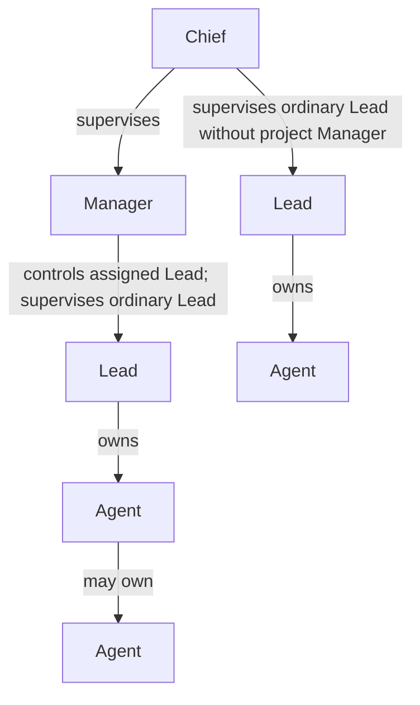

# Coordination

[Documentation index](../README.md) · [Project orchestration](../guides/project-orchestration.md)

Pi Herdsman separates supervision, execution ownership, and physical placement.
Those relationships intentionally do not collapse into one global Agent tree.

## Roles



The same model in text:

```text
supervision: Chief -> Manager -> assigned Lead
             Manager ---------> ordinary Lead in project group
             Chief ------------> ordinary Lead without project Manager
ownership:          Lead -> Agent -> Agent
                    Manager -> Agent (when configured)
                    Chief -> Agent (when configured)
```

An ordinary Lead in a verified project worktree group has the active project
Manager as its supervisor; otherwise Chief supervises it when eligible. A Lead
is managed for project execution only when exactly one current
`ProjectAssignment` for the repository names its exact Pi session. Manager
supervision of an ordinary Lead permits bounded discovery and communication,
including live inspection, persisted transcript access when available, and
cooperative steering through authorized messages. It does not grant project
execution control, Agent ownership, or automatic project-result delivery. The
Lead may reply explicitly with `message_supervisor`. Supervision does not
grant Agent ownership: Manager and Chief can own only Agents they directly start
from their own exact Pi session, when their effective `agents` profile permits
it.

### Lead

Every normal session starts as a Lead. A Lead owns its assigned objective and
its direct Agents. A delegation-enabled Agent may in turn own only the Agents
its definition permits.

A Lead and its recursively owned Agent hierarchy form a **herd**, its internal
team. Reviews by any member of the herd are internal, regardless of which Agent
definitions are available. They inform the Lead's decisions, not user or
supervisor review or approval. Manager and Chief may separately own their own
direct Agent trees when explicitly enabled; those trees do not become part of
a supervised Lead's herd.

Lead execution configuration is separate from role and authority. An ordinary
Lead uses its session's `flexible` or `orchestrate` preference, selecting
`flexible-lead` or `orchestrator-lead`; a Manager-assigned Lead uses
`managed-lead`. These definitions configure execution, not ownership or
supervision. Only the exact current `ProjectAssignment` establishes Manager
authority, and Lead-owned Agent trees remain governed by the existing durable
ownership model. Session kind is immutable and exact-session-bound, independent
of assignment authority. Managed sessions cannot select ordinary execution
profiles or activate Manager or Chief, even after retirement.

### Manager

Manager is a dedicated project-coordination mode. It controls only Leads named
by current `ProjectAssignment` records for its repository, and additionally
supervises eligible ordinary Leads throughout its verified worktree group for
the same direct-report observation and communication capabilities as assigned
Leads. Manager may optionally start its own Agents using definitions in its
effective `agents` profile. This does not grant control over supervised Leads'
Agents or alter project assignments or authority. Its reserved `manager`
definition customizes instructions, ordinary tool selection, and this
direct-delegation allowlist.

Project implementation, technical conflict repair, and validation belong to
assigned Leads and their Agent trees. The Manager owns
project-level integration decisions and may use `merge_project` to fast-forward
an accepted assigned branch into the verified primary branch when local-merge
permission is enabled. Manager's Git integration does not grant ownership of
the Lead's Agents or transfer responsibility for technical validation. The
Successful integration normally triggers guarded removal of that exact source
checkout and retirement of its assignment. A `cleanup_pending` result reports
the partial outcome truthfully; an authorized retry with the same accepted
SHA can retry cleanup, while an absent checkout is reconciled only after Git
proves the SHA is on the verified primary branch.

### Chief

Chief is an optional workspace-neutral supervision mode for one Herdr runtime.
It acts on current Managers and ordinary Leads without an active project
Manager. Ordinary Leads with a verified active project Manager are nested
under that Manager, not actionable Chief reports. Assigned Leads remain under
the Manager role even if its process is unavailable. Chief may optionally
start its own Agents using definitions in its effective `agents` profile; that
direct ownership is separate from supervision and does not include staff
Agents.

Chief can observe bounded descendant summaries but acts only on direct reports.
Its reserved `chief` definition customizes instructions and ordinary tool
selection, not its workspace-neutral scope or supervision authority. Chief
definitions accept global customization only; project-local policy does not
change its behavior.

### Agent

An Agent performs one bounded delegated assignment for its exact owner.
Delegation-enabled Agents may own permitted direct Agents. Managed Agents do not
participate in Manager, Chief, staff, supervisor, or peer authority.

## Project scope

A Herdsman **project** is the coordination scope corresponding to one Herdr Git
worktree group: its primary workspace plus linked-worktree workspaces.

Manager authority is scoped to that group. A Lead in the primary workspace may
enter Manager mode; a Lead in a linked-worktree workspace remains a Lead. An
ordinary Git primary workspace does not need an existing linked worktree before
Manager activation; the first project delegation can create one.

An optional user-wide auto-start preference can attempt the same Manager startup
for a session with no persisted role intent in the primary workspace. Explicit
session intent takes precedence, and automatic activation does not persist a
Manager role.

Workspace membership is physical placement, not assignment ownership. Multiple
Leads can share a workspace, and a branch can have a worktree without implying
that every session in that workspace owns its work.

## Project work belongs to a branch

Manager-delegated project work is durable and keyed by repository plus semantic
Git branch.

Within one repository, the branch is the public work handle. A Lead is the
current executor. The assignment's exact Pi session ID is an internal executor
identity; exact session IDs are used only when acting on a live Lead.

Because durable work is not keyed by a Manager or primary workspace identity, a
replacement Manager or replacement primary workspace for the same repository
does not create a new project assignment. Current Herdr topology is derived
again when the work is observed or resumed.

```text
project work
    ├─ branch feat/a → current Lead → Agent tree
    └─ branch feat/b → current Lead → Agent tree
```

The assignment is the durable indicator that project work remains open. It
survives Manager turnover and runtime loss; current Herdr placement is derived
again when the work is observed or resumed. For an assigned project, Herdsman
automatically returns each completed direct Lead response as a project message
for the Manager role. If managed Agent work is active, the herd run owns that
handoff until it settles, and the settled response should summarize outcome,
validation, and important unresolved points. Routine information that can wait
should go through the automatic result; timely questions, clarifications, or
warnings may use nonblocking `message_supervisor`. This is ordinary
coordination, not assignment state; there is no deduplication between a
message and a later result.
Project assignments end on successful Herdr worktree removal or verified Git
checkout absence—not on settlement, review, or direct user interaction.
Retirement preserves Managed Lead identity, session history and exact Agent
ownership without asserting completion or acceptance. See
[Project orchestration](../guides/project-orchestration.md) for the workflow.

`stop_lead` pauses assigned execution while preserving the assignment, Pi
session, branch, and worktree; `resume_project` resumes the existing
assignment while its checkout exists. These operations do not change project
authority. Successful Herdr worktree removal or verified checkout absence
retires the matching assignment and any still-pending project messages while
preserving the Git branch. Manually continuing the
exact assigned Pi session remains managed; `managed-lead` is launch policy,
not authority.
A complete Git worktree inventory that verifies the checkout is absent retires
the exact assignment and pending project messages, even when a Herdr removal
event was missed. Failed or ambiguous inventory preserves the assignment.
`resume_project` cannot restore a retired assignment; a new delegation may
reuse the remaining Git branch.

For the task-oriented workflow, see
[Project orchestration](../guides/project-orchestration.md). Exact operations
live in [Staff tools](../reference/staff.md).

## Direct edges only

Coordination crosses one authority edge at a time:

| Direction | Interface                                   | Boundary                                            |
| --------- | ------------------------------------------- | --------------------------------------------------- |
| Up        | `message_supervisor` / automatic results    | Assigned Lead -> Manager                            |
| Down      | `message_staff` / project operations        | Manager -> assigned Lead                            |
| Up        | `message_supervisor`                        | Ordinary Lead -> Manager or Chief; Manager -> Chief |
| Down      | `message_staff`                             | Manager -> ordinary Lead (cooperative steering)     |
| Sideways  | `message_peer`                              | Lead <-> Lead or Manager <-> Manager                |
| Ownership | Agent controls / `reply_agent`; `ask_owner` | owner <-> directly owned Agent                      |

A supervisor may observe bounded descendant state without gaining descendant
control. Questions and messages are not implicitly forwarded through
intermediate coordinators.

Peer reachability is distinct from supervision authority. Manager-to-Manager
peers remain global. Ordinary Leads can peer globally, but when either Lead has
an exact current `ProjectAssignment`, both must belong to the same verified
Herdr worktree group on the same socket. Assignment state determines whether a
Lead is managed; Herdr topology determines the group. A branch, checkout name,
cwd, or presentation label alone establishes neither. Exact session targeting
does not bypass eligibility, and queued delivery rechecks the recipient's
current boundary while retaining the sender's submission-time scope.
Assignment mutations and peer authorization share a short-lived user-global
process lock. Herdsman scans and validates the existing branch-keyed assignment
records across all socket namespaces while holding it; only a complete
no-match proves a Lead ordinary. Thus an ordinary Lead with no Git worktree
group remains globally reachable. Corrupt, ambiguous, or incomplete evidence
fails closed. Assignment records remain the sole durable authority; no session
index is maintained.
For peers on another Herdr socket, Herdsman uses their live generation-bound
published group and socket-scoped assignment evidence; it does not add a
cross-socket topology RPC. Delivery always rechecks the recipient locally.

Leads use nonblocking `message_supervisor` for timely coordination with their
effective supervisor; Manager uses nonblocking `message_staff` for requests,
clarifications, instructions, or steering. Routine information that can wait
belongs in the automatic result. Legitimate messages and later results are not
deduplicated. Manager has direct-report and project tools; Chief has
direct-report tools but no project tools.

## Usage follows ownership

Session usage uses Pi's native token and cost records. In ordinary sessions,
`/agents stats` covers the current Pi session and transitively owned managed
Agents whose exact persisted identities can be verified.

When the current session is an active Manager, stats additionally cover the
Lead sessions named by its current durable project assignments, along with each
included Lead's transitively owned managed-Agent sessions. Ordinary supervised
Leads are not included. The Manager's own
directly owned Agents remain included as well. Durable assignment identity
selects managed Leads; live herdr topology is not required, so a paused Lead or
missing worktree does not by itself exclude a still-assigned project. Retired
assignments no longer contribute to current Manager stats.

Known assignment IDs may be resolved through Pi's native global session
inventory. That discovery locates the exact assigned session but never
establishes ownership or scope by itself: project assignments select Leads,
and durable Agent ownership determines their Agent trees. Usage that cannot be
verified within the in-scope sessions is omitted and reported as incomplete
coverage rather than guessed. Chief staff, peer Leads, and unrelated sessions
remain outside the accounting scope.

See [Commands](../reference/commands.md#herdsman-stats) for the exact presentation
and coverage rules.

## System responsibilities

| System          | Responsibility                                                                       |
| --------------- | ------------------------------------------------------------------------------------ |
| **Pi**          | Session history, turns, model interaction, and conversation continuity               |
| **Pi Herdsman** | Assignment ownership, coordination, project-work semantics, and authority validation |
| **herdr**       | Processes, panes, tabs, workspaces, placement, and Git worktree topology             |
| **Git**         | Branches, commits, and repository state                                              |

Physical layout and display metadata are evidence or presentation, not
coordination authority. Control requires current validated identity and fails
closed when evidence is stale, missing, duplicated, or ambiguous.

## Role transitions

`/manager` enters Manager mode from an eligible Lead in the primary workspace.
`/manager leave` returns to Lead while preserving project work.

`/chief` enters Chief mode from an eligible ordinary Lead. A Manager cannot
activate Chief. `/chief leave` returns to Lead.

Both special roles restore the Lead tool baseline when they are left. Exact
eligibility and command behavior are documented in
[Commands](../reference/commands.md).

## See also

- [Project orchestration](../guides/project-orchestration.md)
- [Delegation](delegation.md)
- [Agents and identity](agents.md)
- [Staff tools](../reference/staff.md)
- [Supervisor tools](../reference/supervisor.md)
- [Peer tools](../reference/peer.md)
